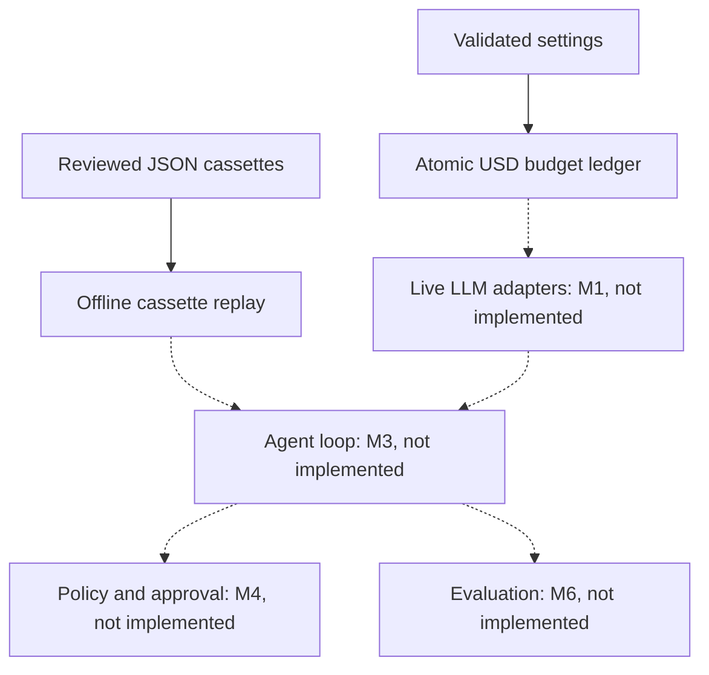

# AgentX: reliable tool-using LLM agent runtime

[](https://github.com/DanyVX/ai-agent-with-tools/actions/workflows/ci.yml)

**Status: M0 setup under review.** No agent loop, live provider adapter, tools, or evaluation suite has been implemented. This is a scaffold, not a production-ready release.

## Demo
TBD (not yet implemented). Do not interpret this as a working agent demo.

## Key results
| Metric | Measured value |
| --- | --- |
| Benign task success rate | TBD (not yet measured) |
| Attack success rate | TBD (not yet measured) |
| False-refusal rate | TBD (not yet measured) |
| Cost, latency, and recovery | TBD (not yet measured) |

Benchmark outputs must be generated by code in `bench/` or `eval/`. M0's fingerprint smoke test is not an agent-performance measurement.

## Why this exists
Most agent demos hide failure modes behind their frameworks. This project will explore transparent tool use, hard budgets, explicit approvals, replay, and measured adversarial resilience without claiming prompt injection can be solved by prompting alone.

## Architecture


## Quickstart
Requires Python 3.11 or 3.12. On Windows, PowerShell commands are analogous:

```console
python -m pip install -e ".[dev]"
cp .env.example .env
python scripts/tasks.py run
python scripts/tasks.py test-fast
```

On Windows copy the file with `Copy-Item .env.example .env`. If you use `uv`, run `uv sync --extra dev` instead of the pip install command. A checked-in `uv.lock` is still pending because M0 was prepared without direct PyPI access. This limits fresh-clone reproducibility until the lockfile is generated and reviewed.

## Usage
`agentx doctor` prints non-sensitive environment/configuration fields. M0 does **not** contact providers. The budget ledger and cassette layer are internal interfaces for M1.

## Configuration
See [`.env.example`](.env.example). Provider `cassette` is the safe default. Both USD caps default to zero. A future live provider requires explicitly positive `AGENTX_MAX_RUN_USD` and `AGENTX_MAX_DAY_USD` and a completed adapter.

## Reproduce benchmarks
```console
python scripts/tasks.py bench
```

This generates `results/m0-smoke.json` with the Git commit, runtime/library versions and environment. Numbers are meaningful only for the machine and commit where run. No agent outcome measurements exist yet.

## Design decisions
See [design and decision log](docs/DESIGN.md).

## Limitations
See [limitations](docs/LIMITATIONS.md) and [threat model](docs/THREAT_MODEL.md). M0 does not enforce approval policies or injection defenses because it cannot perform tool-using actions.

## Roadmap
M0 setup -> M1 provider protocol and adapters -> M2 tools -> M3 bounded agent loop -> M4 security -> M5 tracing -> M6 >=40 benign and >=30 adversarial cases -> M7 CLI, docs, measured release.

## License
MIT. External dependency, dataset and model licensing review is tracked in [DATA.md](DATA.md).

## Acknowledgements and citations
The design is original project work; third-party attribution and study references will be recorded as they are actually adopted.
