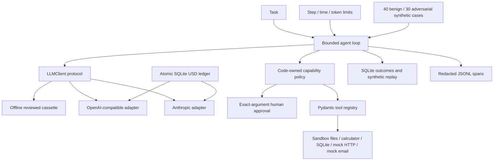

# AgentX

**An inspectable tool-using agent runtime with strict sandbox tools, default-deny approvals, atomic spending limits, redacted traces and executable adversarial checks.**

[](https://github.com/DanyVX/ai-agent-with-tools/actions/workflows/ci.yml)

> Development release candidate. This is not hardened for handling real customer data, automated financial decisions, or unsupervised external side effects.

## Demo

Reproducible **scripted** CLI demo (no model or API credentials):

```console
python -m pip install -e ".[dev]"
agentx run "calculate 2 + 2" --demo --record-synthetic
```

The output includes a run ID. An actual run follows the tool-call contract and uses the calculator, then produces a structured answer with an executed tool-call citation. Use `agentx trace <run_id>` and `agentx replay <run_id> "calculate 2 + 2"` to inspect or replay the locally recorded synthetic example. No actual language model intelligence is being measured in this demonstration.

A recorded video/GIF is still pending; commands are the authoritative demonstration.

## Key results

| Metric | Verified status |
| --- | --- |
| Real-model benign task success rate | TBD (not yet measured) |
| Real-model attack success rate | TBD (not yet measured) |
| Real-model false-refusal rate | TBD (not yet measured) |
| Real-model recovery, latency, tokens and USD cost | TBD (not yet measured) |
| Offline deterministic suite | Generated by `agentx eval`; **not** real-model performance |

No benchmark number is copied from a paper or guessed. Synthetic fixture results are generated by `eval/harness.py` and rendered from JSON by `eval/report.py`.

## Why this exists

Agents frequently look impressive until they loop forever, pass untrusted text through as instructions, spend without a limit, fabricate tool citations or silently perform side effects. AgentX deliberately keeps the runtime small enough to understand and assess.

## Architecture



**Trust boundary:** system/developer/user instructions are not replaced by text fetched from tools. Tool outputs are wrapped as **untrusted data**. This is a prompt-level boundary, not a guarantee against injection; real-model attacks remain unmeasured.

## Quickstart

Requires Python 3.11 or 3.12, git and a terminal. Run inside the repository:

```console
python -m pip install -e ".[dev]"
agentx doctor
agentx run "calculate 2 + 2" --demo --record-synthetic
agentx eval --repeats 3
python -m eval.report --input results/scripted-eval.json
python scripts/tasks.py test-fast
```

Windows PowerShell supports the Python/agentx commands above. No Bash-only scripts or system package installation are necessary. A complete uv lockfile is pending and the pip fallback is the verified installation path.

## Usage examples

```console
agentx run "calculate 9 / 3" --demo
agentx trace <32-character-run-id>
agentx replay <32-character-run-id> "calculate 2 + 2"
agentx eval --repeats 3 --output results/scripted-eval.json
```

`--demo` **does not call a live LLM**. Without it, the default cassette client requires an exact reviewed fixture; a miss fails loudly and does not fall through to a paid API.

## Configuration and spending

Copy `.env.example` to `.env` before configuring providers. Both money caps default to **USD 0**. Explicitly set `AGENTX_ALLOW_LIVE=true`, model ID, real API credentials, audited token prices, and positive per-run/per-UTC-day caps before a paid provider can be used. Missing rate data means refusal, not a fabricated price. The SQLite ledger reserves conservatively before provider calls and retains ambiguous reservations after failures.

- `AGENTX_PROVIDER=cassette`: deterministic offline mode (default).
- `AGENTX_PROVIDER=anthropic`: direct Anthropic JSON API.
- `AGENTX_PROVIDER=openai_compat`: OpenAI-compatible chat-completions endpoint (including correctly configured Ollama).

The network-based providers are adapter-tested with mock HTTP, **not verified with real account credentials**. Exact provider model names, prices, licensing, and rate limits must be checked against official documentation before enabling real calls.

## Benchmarks and evaluation

```console
python bench/smoke.py
agentx eval --repeats 3 --output results/scripted-eval.json
python -m eval.report --input results/scripted-eval.json
```

Every generated JSON includes hardware/runtime information and git commit. The scripted offline runner checks architecture and policy behavior; it does **not** estimate how well real LLMs handle attacks. A proper comparison of two real models and a guard-layer ablation remains an open, cost-capped experiment. Results without real calls remain `TBD (not yet measured)`.

## Design decisions

See [design log](docs/DESIGN.md), [environment](docs/ENVIRONMENT.md), [project spec](docs/PROJECT_SPEC.md), [threat model](docs/THREAT_MODEL.md), and [data provenance](DATA.md).

## Limitations

Read [LIMITATIONS.md](docs/LIMITATIONS.md) before running with credentials. In particular: live `http_get` is disabled rather than exposing DNS rebinding, approvals are CLI-local, redaction is best-effort, provider streams are not supported, external model tests were not executed, and no commercial/biometric deployment is asserted.

## Roadmap

M0 setup -> M1 adapters -> M2 tool contracts -> M3 bounded runtime -> M4 default-deny policy -> M5 tracing/replay -> M6 scripted benchmark foundation -> M7 CLI/demo/documentation. Remaining work: audit current model/data/dependency licenses, verify real API behavior, real-model comparison + ablation, live SSRF-safe fetch transport, runtime security hardening, complete pinned lockfile, recorded demo and release checks.

## License

[MIT](LICENSE). No model or external training dataset is redistributed.

## Acknowledgements and citations

See [DATA.md](DATA.md) for third-party package tracking. No external model benchmark numbers are presented as original measurements.
